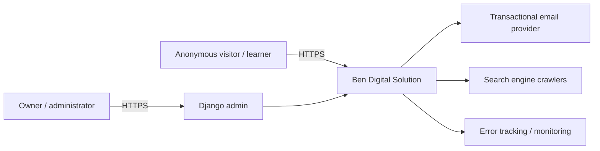
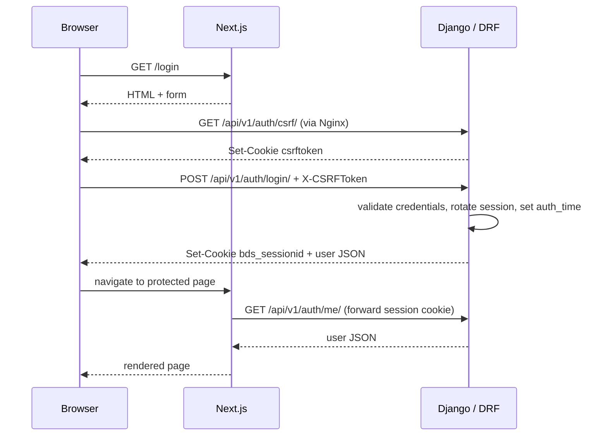
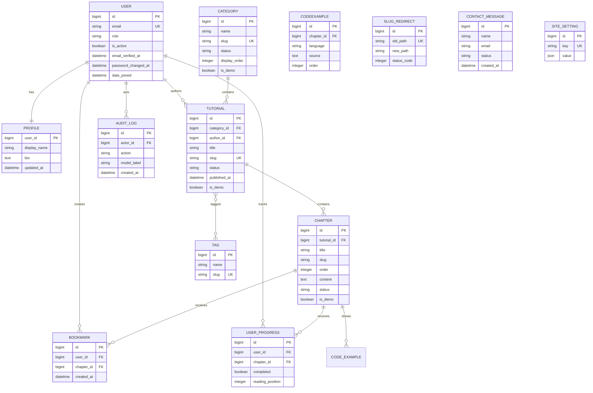
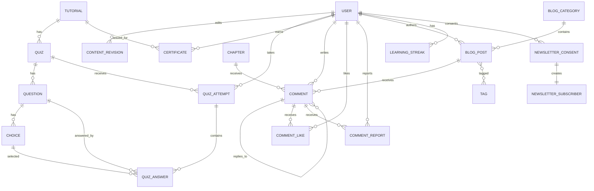

# Architecture and Technical Design — Ben Digital Solution

**Version:** 1.0 (Phase 1)
**Date:** 2026-11-13
**Status:** Accepted for Phase 2 implementation
**Related:** `docs/decisions/`, `docs/API_CONTRACT.md`, `docs/CONTENT_PLAN.md`

This document is the system context, topology, data model, permission matrix, environment inventory, and cache/SEO strategy for the full product. Only Release 1 is implemented until R1 is live.

---

## 1. Scope

- **In scope for this document:** architecture for R1, R2, and R3; field-level R1 model specifications; permission matrix; API conventions; rendering and deployment topology.
- **Out of scope:** application code, migrations, CI workflows, and deployments. Those belong to Phases 2–7.
- Architecture is designed for the full product, but migrations and features are built release by release.

## 2. System context



- One primary domain serves public pages, the API, admin, and media.
- Public content is readable without JavaScript.
- The owner manages content and users in Django admin.
- Email is the only external service required by R1; error tracking is optional and env-configured.

## 3. Container and deployment topology

```mermaid
flowchart TB
    B[Browser] -->|80/443| N[Nginx]
    N -->|"/" , "/_next"| F[Next.js 16 server :3000]
    N -->|"/api/v1" , "/admin"| D[Gunicorn + Django :8000]
    N -->|"/static" , "/media"| V[(Static and media volumes)]
    F -->|server-side fetch API_INTERNAL_URL| D
    D -->|revalidation webhook| F
    D --> PG[(PostgreSQL 18.7)]
    D --> RD[(Redis 8.4)]
    D -->|SMTP/API| EM[Email provider]
    D -.->|optional| SEN[Sentry]
    F -.->|optional| SEN
```

- Docker Compose services: `nginx`, `frontend`, `backend`, `db`, `redis` (production); development adds no Nginx and uses Next.js rewrites.
- Only Nginx publishes ports. PostgreSQL, Redis, Django, and Next.js are on the internal network.
- TLS terminates at Nginx (Let's Encrypt). HTTP redirects to HTTPS.
- Media and static files live on named volumes; PostgreSQL data on a named volume.
- Gunicorn worker count and container memory limits are set from measured staging data in Phase 7.
- Health checks exist for every container; `/api/v1/ready/` is the application-level readiness check.

## 4. Technology decisions

| Area | Decision | Reference |
|---|---|---|
| Backend | Django 5.2 LTS, DRF 3.18, PostgreSQL 18.7, Python 3.14.8 | `PROJECT_STATUS.md` §9 |
| Frontend | Next.js 16.4.6 App Router, React 19.3.1, TypeScript 5.9.x, Tailwind 4.3.5 | ADR-0008 |
| Auth | Django sessions + CSRF, `cached_db` sessions | ADR-0001 |
| Cache/throttles | Redis 8.4.x | ADR-0002 |
| Background work | No Celery in R1; evaluated for R2 | ADR-0003 |
| Content hierarchy | Category → Tutorial → Chapter | ADR-0004 |
| Rendering | ISR for public content, dynamic for auth/learner/search | ADR-0005 |
| Revisions | Django admin history in R1; `ContentRevision` in R2 | ADR-0006 |
| Demo data | Per-record `is_demo` flag | ADR-0007 |
| Topology | Single domain, `/api/` reverse proxy | ADR-0009 |
| API | `/api/v1/`, consistent error envelope | ADR-0010 |

## 5. Monorepo layout

The repository is initialised in Phase 2. No directories below are created in Phase 1.

```text
/
├── backend/
│   ├── manage.py
│   ├── config/
│   │   ├── settings/          # base.py, dev.py, prod.py, test.py
│   │   ├── urls.py
│   │   ├── asgi.py
│   │   └── wsgi.py
│   ├── apps/
│   │   ├── accounts/          # User, Profile, auth API
│   │   ├── catalog/           # Category, Tag, Tutorial, Chapter, CodeExample
│   │   ├── learning/          # Bookmark, UserProgress
│   │   ├── contact/           # ContactMessage
│   │   ├── seo/               # SlugRedirect, sitemap/redirect API
│   │   └── common/            # SiteSetting, audit log, base serializers
│   ├── tests/
│   └── requirements/          # base.txt, dev.txt, prod.txt
├── frontend/
│   ├── src/app/
│   ├── src/components/
│   ├── src/lib/api/
│   ├── src/lib/auth/
│   ├── src/styles/
│   └── tests/
├── infra/
│   ├── nginx/
│   ├── compose/               # compose.yaml, compose.prod.yaml
│   └── scripts/               # backup, restore, deploy helpers
├── docs/
│   ├── decisions/
│   ├── PROJECT_STATUS.md
│   ├── ARCHITECTURE.md
│   ├── API_CONTRACT.md
│   ├── CONTENT_PLAN.md
│   └── RISK_REGISTER.md
├── .github/workflows/
├── .env.example
├── .gitignore
├── .venv/                     # local only, gitignored
└── README.md
```

Rules:

- Django apps are feature-scoped; shared utilities live in `common`.
- No frontend code imports backend code; the contract is HTTP + OpenAPI.
- Tests live next to the app (`apps/<app>/tests/`) or under `backend/tests/` for cross-app tests.
- `scripts/` and `infra/` contain no secrets.

## 6. Authentication and session flow

Full decision: ADR-0001.

### 6.1 Login sequence



### 6.2 Session lifecycle

| Event | Behaviour |
|---|---|
| Login | Session key rotated, `auth_time` recorded, `last_login` updated |
| Page reload | `GET /auth/me/` restores state from the cookie |
| Logout | Server session flushed; cookie expired |
| Password change | Other sessions invalidated via `password_changed_at` vs `auth_time`; current session re-issued |
| Password reset | All sessions invalidated; user logs in again |
| Deactivation | `is_active=False`; existing sessions resolve to anonymous |
| Deletion | User removed; cascades profile, bookmarks, progress; sessions resolve to anonymous |
| Multi-tab | Shared cookie; logout invalidates all tabs; `401` triggers redirect |

### 6.3 CSRF

- `GET /api/v1/auth/csrf/` sets the `csrftoken` cookie.
- Unsafe methods require `X-CSRFToken` matching the cookie.
- `SessionAuthentication` enforces CSRF for authenticated requests; the custom exception handler returns `csrf_failed` for CSRF failures.
- CSRF failures return `403` and are logged with the request ID.

### 6.4 Unverified accounts

Registration creates an active user with `email_verified_at = null`. Unverified users can log in, view their profile, edit display name/bio, resend verification, and log out. They cannot create bookmarks, save progress, or change password until verified. The permission matrix in §8 records this.

## 7. Data model

### 7.1 Principles

- PostgreSQL with explicit constraints, `on_delete`, timestamps, and indexes only for real query patterns.
- Default primary key: `BigAutoField`; public content is addressed by slug, never by numeric ID.
- No redundant derived values except `estimated_reading_time`, which is computed and stored at save time (documented formula: words ÷ 200, ceiling, minimum 1).
- No `GenericForeignKey` in R1. R2 comment targeting is decided by an ADR; the default is explicit nullable FKs to `Chapter` and `BlogPost` with a check constraint.
- Custom user model from the first migration.
- Full-product ERD is specified; migrations are created only for R1 models.

### 7.2 R1 ERD



`TUTORIAL_TAG` is the implicit M2M join table. `SLUG_REDIRECT`, `CONTACT_MESSAGE`, `SITE_SETTING`, and `AUDIT_LOG` are standalone.

### 7.3 R2/R3 ERD outline



R2/R3 models are not created until their release. The comment target strategy, certificate eligibility rules, quiz scoring, and analytics aggregates are decided in their phase ADRs.

### 7.4 R1 model specifications

#### User (`accounts.User`)

| Field | Type | Constraints / notes |
|---|---|---|
| id | BigAutoField | PK |
| email | EmailField(254) | Lower-cased in manager; unique via `UniqueConstraint(Lower("email"))` |
| password | CharField(128) | Argon2 hasher preferred; PBKDF2 fallback documented |
| role | CharField(20) | Choices: `learner`, `editor`, `moderator`, `admin`; default `learner` |
| is_active | BooleanField | Default `True`; deactivation sets `False` |
| is_staff | BooleanField | Default `False`; `True` for admin/editor |
| is_superuser | BooleanField | Default `False` |
| email_verified_at | DateTimeField | Nullable |
| password_changed_at | DateTimeField | Default `timezone.now`; updated on password change/reset |
| date_joined | DateTimeField | Default `timezone.now` |
| last_login | DateTimeField | Nullable |

Constraints/indexes: case-insensitive unique email; `(role, is_active)`. `Meta.ordering = ["-date_joined"]`.

Deletion: account deletion removes the user and cascaded learner data; contact messages are retained per policy and anonymised if they match the email.

#### Profile (`accounts.Profile`)

| Field | Type | Constraints / notes |
|---|---|---|
| user | OneToOneField(User) | `on_delete=CASCADE`, `primary_key=True`, related_name `profile` |
| display_name | CharField(80) | Required, trimmed |
| bio | TextField(500) | Blank allowed |
| created_at / updated_at | DateTimeField | Auto timestamps |

No avatar in R1 (deferred per prompt §7.4).

#### Category (`catalog.Category`)

| Field | Type | Constraints / notes |
|---|---|---|
| id | BigAutoField | PK |
| name | CharField(100) | Required |
| slug | SlugField(120) | Unique |
| description | TextField | Blank allowed |
| icon | CharField(50) | Allowlisted identifier (`code`, `terminal`, `database`, `tools`, `globe`, `chart`) |
| display_order | PositiveIntegerField | Default 0 |
| status | CharField(10) | `draft`, `published`, `archived`; default `draft` |
| is_demo | BooleanField | Default `False` |
| created_at / updated_at | DateTimeField | Auto timestamps |

Indexes: `slug` unique; `(status, display_order)`. Constraint: published category requires `published_at`? Categories have no publication date in R1; status alone is sufficient.

#### Tag (`catalog.Tag`)

| Field | Type | Constraints / notes |
|---|---|---|
| id | BigAutoField | PK |
| name | CharField(60) | Required |
| slug | SlugField(60) | Unique |
| created_at | DateTimeField | Auto |

#### Tutorial (`catalog.Tutorial`)

| Field | Type | Constraints / notes |
|---|---|---|
| id | BigAutoField | PK |
| category | ForeignKey(Category) | `on_delete=PROTECT`, related_name `tutorials` |
| author | ForeignKey(User) | `on_delete=PROTECT`, related_name `authored_tutorials` |
| title | CharField(160) | Required |
| slug | SlugField(160) | Globally unique (ADR-0004) |
| summary | TextField(300) | Required for cards/SEO |
| difficulty | CharField(12) | `beginner`, `intermediate`, `advanced`; default `beginner` |
| estimated_reading_time | PositiveSmallIntegerField | Minutes; computed from chapters at save |
| status | CharField(10) | `draft`, `published`, `archived`; default `draft` |
| published_at | DateTimeField | Nullable; required when published |
| is_demo | BooleanField | Default `False` |
| tags | ManyToManyField(Tag) | Blank allowed; related_name `tutorials` |
| created_at / updated_at | DateTimeField | Auto timestamps |

Constraints: `slug` unique; `CheckConstraint(status="published" -> published_at IS NOT NULL)`; `CheckConstraint(estimated_reading_time >= 1 OR status != "published")`.
Indexes: `(status, -published_at)`, `(category, status)`, `(difficulty, status)`.
Ordering: `-published_at`, `id`.

#### Chapter (`catalog.Chapter`)

| Field | Type | Constraints / notes |
|---|---|---|
| id | BigAutoField | PK |
| tutorial | ForeignKey(Tutorial) | `on_delete=CASCADE`, related_name `chapters` |
| title | CharField(160) | Required |
| slug | SlugField(160) | Unique within tutorial |
| summary | TextField(300) | Blank allowed |
| content | TextField | Markdown source |
| order | PositiveIntegerField | 1-based position |
| estimated_reading_time | PositiveSmallIntegerField | Minutes; computed on save |
| status | CharField(10) | `draft`, `published`, `archived`; default `draft` |
| published_at | DateTimeField | Nullable; required when published |
| is_demo | BooleanField | Default `False` |
| created_at / updated_at | DateTimeField | Auto timestamps |

Constraints: `UniqueConstraint(tutorial, slug)`; `UniqueConstraint(tutorial, order)`; published implies `published_at` is not null.
Indexes: `(tutorial, status, order)`, `(status, -published_at)`.
Ordering: `order`, `id`.

Reordering: the admin service renumbers chapters inside a transaction; direct order swaps are rejected by the unique constraint.

#### CodeExample (`catalog.CodeExample`)

| Field | Type | Constraints / notes |
|---|---|---|
| id | BigAutoField | PK |
| chapter | ForeignKey(Chapter) | `on_delete=CASCADE`, related_name `code_examples` |
| language | CharField(16) | Allowlist: `html`, `css`, `javascript`, `python`, `sql`, `bash`, `text` |
| title | CharField(120) | Required |
| source | TextField | Required; never executed |
| expected_output | TextField | Blank allowed |
| order | PositiveIntegerField | 1-based |
| created_at / updated_at | DateTimeField | Auto timestamps |

Constraint: `UniqueConstraint(chapter, order)`. Index: `(chapter, order)`.
Ordering: `order`, `id`.

#### ChapterImage (`catalog.ChapterImage`)

| Field | Type | Constraints / notes |
|---|---|---|
| id | BigAutoField | PK |
| chapter | ForeignKey(Chapter) | `on_delete=CASCADE`, related_name `images` |
| image | FileField | `chapter-images/`, JPEG/PNG/WebP only, 2 MB maximum, extension/content-type/magic-byte validation |
| alt_text | CharField(200) | Required unless `decorative` is true |
| decorative | BooleanField | Default false; decorative images must have empty `alt_text` |
| caption | CharField(200) | Blank allowed |
| order | PositiveIntegerField | 1-based |
| created_at / updated_at | DateTimeField | Auto timestamps |

Constraint: `UniqueConstraint(chapter, order)`. Index: `(chapter, order)`. Admin upload only; no public endpoint.

#### VideoEmbed (`catalog.VideoEmbed`)

| Field | Type | Constraints / notes |
|---|---|---|
| id | BigAutoField | PK |
| chapter | ForeignKey(Chapter) | `on_delete=CASCADE`, related_name `video_embeds` |
| provider | CharField(10) | `youtube` or `vimeo`; derived from the parsed source URL |
| source_url | URLField(255) | HTTPS YouTube/Vimeo URL only |
| video_id | CharField(64) | Parsed ID only; arbitrary HTML is never stored |
| title | CharField(120) | Required; used as iframe title |
| order | PositiveIntegerField | 1-based |
| created_at / updated_at | DateTimeField | Auto timestamps |

Constraint: `UniqueConstraint(chapter, order)`. Index: `(chapter, order)`. The API returns a derived `embed_url` from the allowlisted provider and parsed ID.

#### SlugRedirect (`seo.SlugRedirect`)

| Field | Type | Constraints / notes |
|---|---|---|
| id | BigAutoField | PK |
| old_path | CharField(500) | Unique; absolute path beginning with `/` |
| new_path | CharField(500) | Absolute path beginning with `/`; must not equal `old_path` |
| status_code | PositiveSmallIntegerField | Default `301`; only `301`/`308` allowed |
| is_active | BooleanField | Default `True` |
| created_at | DateTimeField | Auto |

Indexes: `old_path` unique; `(is_active, old_path)`. Service validates against loops (old/new chains) and duplicate targets.

#### Bookmark (`learning.Bookmark`)

| Field | Type | Constraints / notes |
|---|---|---|
| id | BigAutoField | PK |
| user | ForeignKey(User) | `on_delete=CASCADE`, related_name `bookmarks` |
| chapter | ForeignKey(Chapter) | `on_delete=CASCADE`, related_name `bookmarks` |
| created_at | DateTimeField | Auto |

Constraint: `UniqueConstraint(user, chapter)` (one bookmark per user per chapter). Index: `(user, -created_at)`.
Ordering: `-created_at`.

#### UserProgress (`learning.UserProgress`)

| Field | Type | Constraints / notes |
|---|---|---|
| id | BigAutoField | PK |
| user | ForeignKey(User) | `on_delete=CASCADE`, related_name `progress` |
| chapter | ForeignKey(Chapter) | `on_delete=CASCADE`, related_name `progress` |
| completed | BooleanField | Default `False` |
| completed_at | DateTimeField | Nullable; set when completed becomes true |
| reading_position | PositiveSmallIntegerField | 0–100 percent; default 0 |
| created_at / updated_at | DateTimeField | Auto |

Constraints: `UniqueConstraint(user, chapter)` (one progress record per user per chapter); `CheckConstraint(reading_position BETWEEN 0 AND 100)`.
Indexes: `(user, chapter)`, `(user, -updated_at)`.
Tutorial progress is computed by aggregating published chapters; no redundant tutorial FK.

#### ContactMessage (`contact.ContactMessage`)

| Field | Type | Constraints / notes |
|---|---|---|
| id | BigAutoField | PK |
| name | CharField(100) | Required |
| email | EmailField(254) | Required |
| subject | CharField(160) | Required |
| message | TextField | Required; max 5000 characters enforced in serializer/form |
| status | CharField(10) | `new`, `handled`, `spam`; default `new` |
| ip_hash | CharField(64) | SHA-256 of IP with a per-site salt; no raw IP stored |
| created_at | DateTimeField | Auto |

Indexes: `(status, -created_at)`, `(created_at)`.
Retention: 12 months unless a deletion request requires earlier removal.

#### SiteSetting (`common.SiteSetting`)

| Field | Type | Constraints / notes |
|---|---|---|
| id | BigAutoField | PK |
| key | CharField(100) | Unique |
| value | JSONField | Type validated in admin/service |
| updated_at | DateTimeField | Auto |

Cached with the `catalog` namespace. Used for site name, contact recipient, and non-secret flags. Secrets never live here.

#### AdministrativeAuditLog (`common.AdministrativeAuditLog`)

| Field | Type | Constraints / notes |
|---|---|---|
| id | BigAutoField | PK |
| actor | ForeignKey(User) | `on_delete=SET_NULL`, `null=True`, related_name `audit_entries` |
| action | CharField(100) | For example `content.publish`, `user.role_change` |
| model_label | CharField(100) | `app_label.ModelName` |
| object_id | CharField(64) | Blank for non-object actions |
| changes | JSONField | Redacted diff; never contains passwords or tokens |
| created_at | DateTimeField | Auto |

Indexes: `(created_at)`, `(actor, -created_at)`, `(model_label, object_id)`.
Retention: 2 years.

### 7.5 Index justification

| Query pattern | Index |
|---|---|
| Published categories ordered for navigation | `Category(status, display_order)` |
| Published tutorials by recency | `Tutorial(status, -published_at)` |
| Tutorials in a category | `Tutorial(category, status)` |
| Tutorials by difficulty filter | `Tutorial(difficulty, status)` |
| Chapter navigation in order | `Chapter(tutorial, status, order)` |
| Recently published chapters | `Chapter(status, -published_at)` |
| Bookmarks for a learner | `Bookmark(user, -created_at)` + unique `(user, chapter)` |
| Progress for a learner | `UserProgress(user, chapter)` + unique `(user, chapter)` |
| Redirect lookup by path | `SlugRedirect(old_path)` unique |
| Contact moderation queue | `ContactMessage(status, -created_at)` |
| Audit investigation | `AdministrativeAuditLog(actor, -created_at)`, `(model_label, object_id)` |
| Full-text search | GIN expression indexes on `SearchVector` for Category, Tutorial, Chapter |
| Case-insensitive login | `UniqueConstraint(Lower("email"))` |

No composite partial indexes are added until a measured query requires them.

### 7.6 Migration order

1. `accounts` — custom User, Profile (must be the first app migration; `AUTH_USER_MODEL` set before any migration).
2. `catalog` — Tag, Category, Tutorial, Chapter, CodeExample.
3. `seo` — SlugRedirect.
4. `learning` — Bookmark, UserProgress.
5. `contact` — ContactMessage.
6. `common` — SiteSetting, AdministrativeAuditLog.
7. Search expression indexes (GIN) in a dedicated migration after models exist.
8. No data migrations in R1 beyond the seed command. Demo and initial content are created by management commands, not migrations.

## 8. Roles and permissions

### 8.1 Roles

| Role | Definition |
|---|---|
| Anonymous | Not authenticated |
| Learner (unverified) | Registered, email not verified |
| Learner (verified) | Email verified |
| Editor | Content CRUD and submit for review; cannot publish; staff admin access limited to content |
| Moderator | R2 only; comment moderation and reports |
| Admin | Publish/archive, manage users and settings, view audit log |

R1 has one human user (owner) with Admin. Editor and Moderator are defined now so the permission model does not need redesign later.

### 8.2 Permission matrix

Legend: Y = allowed; N = denied; S = self/own record only; — = not applicable in R1.

| Action | Anonymous | Learner unverified | Learner verified | Editor | Moderator | Admin |
|---|---|---|---|---|---|---|
| View published catalog/chapters | Y | Y | Y | Y | Y | Y |
| Search published content | Y | Y | Y | Y | Y | Y |
| View draft/archived content | N | N | N | Y (admin) | N | Y (admin) |
| Register | Y | — | — | — | — | — |
| Verify email / resend verification | Y (token) | Y (own) | — | — | — | — |
| Login / logout / session restore | Y | Y | Y | Y | Y | Y |
| Edit own profile | N | S | S | S | S | S |
| Change own password | N | N (verify first) | S | S | S | S |
| Reset forgotten password | Y | Y | Y | Y | Y | Y |
| Deactivate/delete own account | N | S | S | S | S | S |
| Create/remove own bookmarks | N | N | S | S | S | S |
| Save own reading progress | N | N | S | S | S | S |
| View own bookmarks/progress | N | N | S | S | S | S |
| Create/edit draft content | N | N | N | Y | N | Y |
| Publish/archive content | N | N | N | N | N | Y |
| Manage categories/tags | N | N | N | Y (no delete) | N | Y |
| Manage users and roles | N | N | N | N | N | Y |
| Manage site settings | N | N | N | N | N | Y |
| View audit log | N | N | N | N | N | Y |
| Submit contact form | Y | Y | Y | Y | Y | Y |
| Moderate comments/reports | — | — | — | — | Y (R2) | Y (R2) |
| Verify certificate (public) | Y (R2) | Y | Y | Y | Y | Y |

Enforcement:

- DRF permission classes enforce authenticated, verified, staff, and object ownership rules on the backend.
- Django admin `has_*_permission` methods enforce Editor vs Admin publication rights.
- Frontend route guards are UX only; every protected request is authorised again by Django.
- Object-level checks return `404` for content the requester may not see, preventing existence leaks.

## 9. API conventions

Full contract: `docs/API_CONTRACT.md`.

- Base path `/api/v1/`; JSON request/response; UTF-8.
- Session cookie authentication; `X-CSRFToken` on unsafe methods.
- Pagination only where collections can grow: tutorials, chapters (not exposed as a standalone list), search, bookmarks. Categories, tags, and progress summaries return arrays.
- Consistent error envelope and codes (ADR-0010).
- Throttle scopes: `anon`, `user`, `auth`, `password_reset`, `contact`, `search_suggest`.
- OpenAPI via `drf-spectacular`; schema endpoint staff-only in production; CI validates generation.
- Loading strategy: `select_related` for category/author, `prefetch_related` for tags and chapters/code examples; no unbounded nested serialization.
- Query budgets are tested in Phase 3.

## 10. Search architecture

- PostgreSQL full-text search over:
  - `Category.name`, `Category.description`;
  - `Tutorial.title`, `Tutorial.summary`;
  - `Chapter.title`, `Chapter.summary`, `Chapter.content`.
- Weighted vectors: title/summary `A`, content `B`.
- GIN expression indexes per model; no separate search table in R1.
- Ranking: `SearchRank` descending, then `published_at` descending.
- Query parsing: `websearch_to_tsquery`; empty or one-character queries return `400`.
- Suggestions: prefix matching on titles via `to_tsquery` with `:*`, limit 8, throttled.
- `pg_trgm` is **not** enabled initially; it is added only if measured typo misses justify the index cost. This is recorded in the Phase 3 report if used.
- Search results exclude drafts, archived content, and `is_demo` records; they are never publicly cached or indexed.
- Search API responses carry `Cache-Control: no-store`; server-side search result caching (if added) is keyed by normalized query and invalidated on content change.

## 11. Media and embeds

- Uploads are validated for content type, extension, magic bytes, and size; images are limited to JPEG/PNG/WebP, maximum 2 MB.
- Media is stored on a local Docker volume, served by Nginx at `/media/`; files are never executed or served with active content types.
- Image alt text is required at the content level; decorative images are marked with an empty alt in Markdown or with the `ChapterImage.decorative` flag.
- Video embeds accept only parsed YouTube and Vimeo URLs; arbitrary iframe HTML is stripped by the Markdown sanitiser.
- No user-facing upload endpoint exists in R1; uploads happen through Django admin.
- Future S3-compatible storage requires an ADR and does not change the media URL contract.

## 12. SEO architecture

| Item | Implementation |
|---|---|
| Metadata | Next.js Metadata API per route; unique title/description; canonical from `SITE_URL` |
| Open Graph / social | Per-page OG title, description, image; no fabricated values |
| JSON-LD | `Organization` on the site root; `Course` on tutorials; `Article` on chapters; `BreadcrumbList` on category/tutorial/chapter |
| Sitemap | Next.js `sitemap.ts` from published APIs; only published, non-demo content; lastmod = `updated_at`; split if over 50,000 URLs |
| robots.txt | Next.js `robots.ts`; allow public content; disallow `/api/`, `/admin/`, auth, profile, bookmarks, progress, search; sitemap reference |
| Canonicals | Current slug only; old slugs redirect 301 |
| Indexing exclusions | Auth, learner pages, search, admin, drafts carry `noindex` |
| Revalidation | On publish/edit/unpublish via tag webhook (ADR-0005) |
| 404 handling | Unknown or unpublished content returns a real 404, no soft-404 |

Structured data is emitted only when the underlying data is real (author, dates, course name). No ratings or review counts are fabricated.

## 13. Caching strategy

### 13.1 Server-side cache (Redis)

| Key | Contents | TTL | Invalidated by |
|---|---|---|---|
| `bds:v1:home` | Homepage aggregate | 60 s | Category/tutorial/chapter publish/edit/unpublish |
| `bds:v1:categories` | Category list | 300 s | Category change |
| `bds:v1:category:{slug}` | Category detail payload | 300 s | Category/tutorial change |
| `bds:v1:tutorial:{slug}` | Tutorial detail + chapter list | 300 s | Tutorial/chapter change |
| `bds:v1:chapter:{tutorial}:{chapter}` | Chapter payload, code examples, TOC | 300 s | Chapter/code example change |
| `bds:v1:search:{hash}` | Search results (optional; only if measurements justify it) | 60 s | Content change (namespace bump) |
| `bds:v1:facets` | Search facets (R2) | 600 s | Content change |
| `bds:v1:redirects` | Slug redirect map | 300 s | Slug change |
| `bds:v1:sitemap` | Sitemap source payload | 600 s | Content change |
| `bds:v1:settings` | SiteSetting values | 600 s | Setting change |
| Sessions | `cached_db` session data | Session expiry | Logout/password change |
| Throttles | DRF counters | Per scope | Window expiry |

Invalidation deletes exact keys and version-suffixed namespaces; it does not use wildcard scans in production. Content signals emit a list of keys to delete.

### 13.2 HTTP caching

- Public catalog GETs: `public, max-age=60..300, stale-while-revalidate=60`.
- Auth/learner/contact: `no-store`.
- Static assets: immutable with content hashes.
- ETag/Last-Modified may be added where DRF supports it; not required in R1.

### 13.3 Next.js cache

- ISR pages use tags listed in ADR-0005.
- Django invalidates Redis first, then calls the Next.js webhook with the same tags.
- Webhook failure is logged and recorded; the TTL bounds staleness.

## 14. Environment variables

Template: `.env.example` (safe placeholders only).

| Variable | Scope | Required | Secret | Notes |
|---|---|---|---|---|
| `DJANGO_SETTINGS_MODULE` | backend | Yes | No | `config.settings.dev` / `prod` / `test` |
| `DJANGO_SECRET_KEY` | backend | Yes | Yes | Long random value; unique per environment |
| `DJANGO_DEBUG` | backend | Yes | No | `False` in production |
| `DJANGO_ALLOWED_HOSTS` | backend | Yes | No | Comma-separated |
| `DJANGO_CSRF_TRUSTED_ORIGINS` | backend | Yes | No | Canonical origin(s) with scheme |
| `SITE_NAME` | backend | Yes | No | `Ben Digital Solution` |
| `SITE_URL` | backend | Yes | No | Canonical public origin |
| `DATABASE_URL` | backend | Yes | Yes | PostgreSQL DSN |
| `POSTGRES_DB` / `POSTGRES_USER` / `POSTGRES_PASSWORD` | db | Yes | Password yes | Used by the database container |
| `REDIS_URL` | backend | Yes | No | `redis://redis:6379/0` |
| `SESSION_COOKIE_SECURE` | backend | Yes | No | `True` in production |
| `CSRF_COOKIE_SECURE` | backend | Yes | No | `True` in production |
| `SECURE_SSL_REDIRECT` | backend | Yes | No | `True` in production |
| `EMAIL_BACKEND` | backend | Yes | No | Console in dev; SMTP/API in prod |
| `EMAIL_HOST` / `EMAIL_PORT` / `EMAIL_USE_TLS` | backend | Prod | No | Provider settings |
| `EMAIL_HOST_USER` / `EMAIL_HOST_PASSWORD` | backend | Prod | Yes | Never logged |
| `DEFAULT_FROM_EMAIL` | backend | Yes | No | Verified sender |
| `CONTACT_RECIPIENT_EMAIL` | backend | Yes | No | Admin inbox |
| `EMAIL_TIMEOUT` | backend | Yes | No | Seconds; default 10 |
| `NEXT_PUBLIC_SITE_URL` | frontend | Yes | No | Canonical origin |
| `NEXT_PUBLIC_API_BASE_URL` | frontend | Yes | No | Browser path `/api/v1` |
| `API_INTERNAL_URL` | frontend | Yes | No | Server-side Django URL |
| `NEXT_TELEMETRY_DISABLED` | frontend | No | No | `1` |
| `REVALIDATE_SECRET` | backend + frontend | Yes | Yes | Shared webhook secret |
| `REVALIDATE_URL` | backend | Yes | No | Next.js webhook URL |
| `MEDIA_ROOT` / `MEDIA_URL` | backend | Yes | No | Local volume path and public prefix |
| `SENTRY_DSN` | backend + frontend | No | Yes | Empty disables tracking |
| `SENTRY_ENVIRONMENT` | backend + frontend | No | No | `development` / `production` |
| `LOG_LEVEL` | backend | No | No | Default `INFO` |
| `THROTTLE_*` | backend | No | No | Override default rates |

Rules: `.env` is gitignored; `.env.example` never contains real credentials; production values come from the host secret store or environment, not images.

## 15. Frontend architecture

- App Router with route groups: `(public)`, `(auth)`, `(learner)`.
- Server Components by default; Client Components only for:
  - search input with debounced suggestions;
  - copy-code button;
  - auth/profile/contact forms;
  - bookmark and progress controls;
  - theme toggle.
- Typed API client in `src/lib/api/client.ts`:
  - server: reads cookies and calls `API_INTERNAL_URL`;
  - browser: same-origin `/api/v1`, includes CSRF header for unsafe methods;
  - maps the standard error envelope to typed errors.
- Auth state is fetched in server layouts from `/auth/me/`; React Context only for theme and client auth status.
- TanStack Query only for client-side bookmark/progress mutations and optimistic updates. Initial data comes from Server Components.
- Forms use React Hook Form + Zod; server field errors are mapped to accessible messages.
- Tailwind 4 design tokens in `src/styles/globals.css`; no component library that duplicates Next.js primitives.
- Loading, empty, error, and success states for every data screen; `error.tsx`, `global-error.tsx`, and `not-found.tsx` exist.
- Accessibility: semantic landmarks, skip link, focus management, reduced motion, and accessible dialogs/menus.

## 16. Observability, health, and backups

- `GET /api/v1/health/`: liveness only, returns `200 {"status":"ok"}`.
- `GET /api/v1/ready/`: checks PostgreSQL (`SELECT 1`) and Redis (`PING`); returns `200` or `503`.
- Request IDs: Nginx/Next/Django propagate `X-Request-ID`; error responses include it.
- Logs: structured JSON in production with level from `LOG_LEVEL`; no tokens, passwords, or raw IPs.
- Error tracking: Sentry-compatible SDK behind `SENTRY_DSN`; disabled when empty. No personal data in breadcrumbs.
- Backups (details in Phase 7 runbook): nightly `pg_dump` plus media sync to off-host storage; retention 7 daily / 4 weekly; restore drill required before the R1 gate.
- Database connection timeouts and Gunicorn worker timeouts are configured in Phase 7.

## 17. Deferred and explicitly out of scope

- Code execution sandbox — documented design only, not built.
- Celery — R2.
- `ContentRevision`, quizzes, comments, certificates, blog, RSS — R2.
- Streaks, newsletter, analytics, recommendations — R3.
- S3-compatible media — documented later option.
- i18n — out of scope; URL and model choices do not preclude locale prefixes.
- Full CSP nonce integration is implemented in Phase 5/7 after the asset inventory exists.

## 18. Consistency check (Phase 1)

| Check | Result |
|---|---|
| Roles in §8 match the permission matrix and ADR-0001 | Yes |
| URL scheme in ADR-0004 matches API paths and frontend routes | Yes |
| All R1 models in §7 appear in the ERD and API payloads | Yes |
| Cache keys in §13 match the invalidation triggers in ADR-0005 | Yes |
| Env vars in §14 match `.env.example` | Yes |
| R2/R3 features are outlined but not scheduled into R1 | Yes |
| No application code or migrations created in Phase 1 | Yes |

## 19. Verification state

- Python 3.14.8 virtual environment at `.venv/` is excluded by `.gitignore`; Git repository initialised in Phase 2 (no commit yet).
- Installed and import-verified: Django 5.2.19, DRF 3.18.3, drf-spectacular 0.30.0, django-filter 26.2, django-environ 0.14.0, psycopg 3.3.8, redis-py 8.1.0, argon2-cffi 25.1.0, pytest 9.2.0, pytest-django 4.14.0, pytest-cov 7.1.0, factory-boy 3.3.3, coverage 7.17.3, Ruff 0.17.5, mypy 1.19.1, django-stubs 5.2.9, pre-commit 4.7.0, pip-audit 2.10.1.
- R1 models, constraints, indexes, and six initial migrations are implemented; migrations apply cleanly to SQLite.
- Phase 2 local evidence: `ruff check` and `ruff format --check` pass; `mypy` reports no issues; `makemigrations --check` reports no drift; `pytest` reports 60 passed at 93.58% coverage; OpenAPI validation reports 0 warnings/0 errors; `check --deploy` reports no issues with a production-shaped environment.
- PostgreSQL 18.7 and Redis 8.4.8 were **not** started locally because the Docker daemon is unavailable. GitHub Actions run `44268233115` exercised both services successfully on Linux; production Compose/Nginx parity on a target host remains unverified.
- The development Compose stack, Docker image build, and Gunicorn startup are unverified locally; Gunicorn is Linux-container only.
- Next.js is not installed in Phase 2; frontend pins and the exact Next.js 16 cache API are validated in Phase 5.
- A Django root placeholder page exists only for the walking skeleton; production `/` remains routed to Next.js by Nginx.
